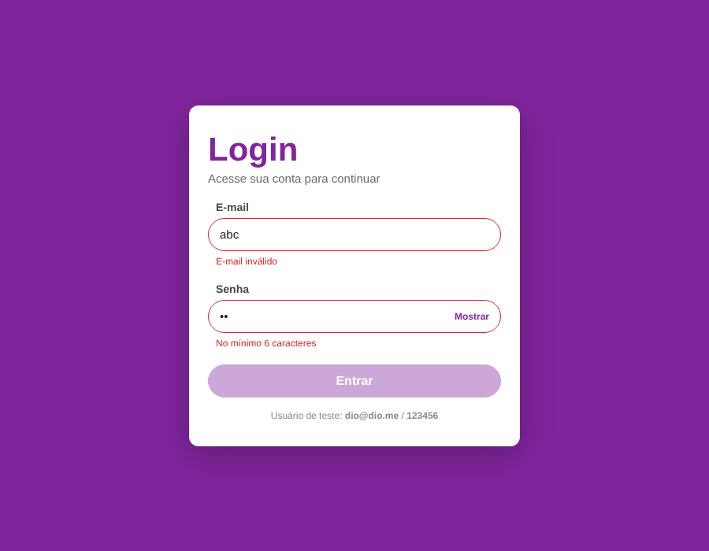
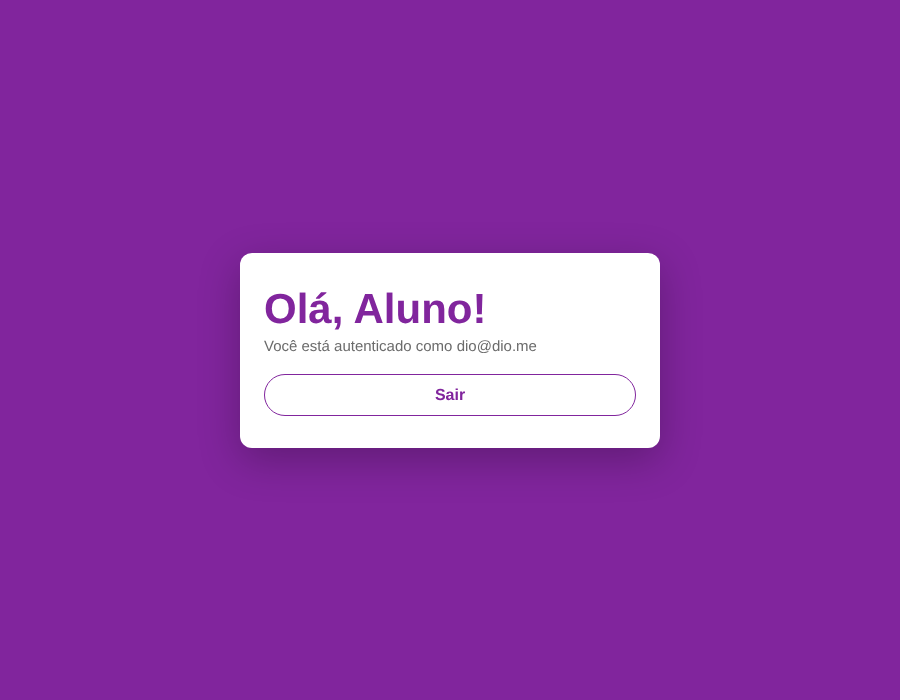

# Desafio DIO — Tela de Login com React + TypeScript

Tela de login com **validação de formulário** e **etapa de autenticação**, desenvolvida em React + TypeScript a partir do projeto base [trilha-react-desafio-4](https://github.com/digitalinnovationone/trilha-react-desafio-4).

| Validação | Autenticado |
|---|---|
|  |  |

## ✨ O que foi implementado

- **Validação com Yup + React Hook Form** (`mode: "onChange"`): e-mail válido e senha com no mínimo 6 caracteres, com mensagens de erro por campo.
- **Botão "Entrar" desabilitado** enquanto o formulário é inválido e com estado de *loading* durante o envio.
- **Autenticação** via `AuthContext` + hook `useAuth()` tipado, com serviço de login simulado (latência de API e erro de credenciais).
- **Sessão persistida** no `localStorage` (permanece logado ao recarregar) e **logout**.
- **Página Home** exibida após o login.
- **Componentes genéricos tipados**: `Input<T>` usa `Control<T>` e `Path<T>` do React Hook Form, servindo para qualquer formulário (não só o de login). `Button` estende `ButtonHTMLAttributes`.
- Botão **mostrar/ocultar senha**, labels e atributos de acessibilidade (`aria-invalid`, `role="alert"`).
- **Testes** com Testing Library cobrindo validação, credenciais incorretas, login e logout.

## 🔑 Usuário de teste

| E-mail | Senha |
|---|---|
| `dio@dio.me` | `123456` |

## 🗂️ Estrutura

```
src/
├── components/
│   ├── Button/        # botão com variant, loading e disabled
│   └── Input/         # input genérico integrado ao React Hook Form
├── contexts/auth/     # AuthProvider + useAuth
├── pages/
│   ├── Login/         # formulário, schema Yup e tipos
│   └── Home/          # tela após autenticação
├── services/auth.ts   # "API" de login simulada
├── App.tsx            # alterna entre Login e Home
└── App.test.tsx       # testes
```

## 🚀 Como rodar

```bash
npm install
npm start          # http://localhost:3000
npm test           # testes
npm run build      # build de produção
```

## 🛠️ Tecnologias

React 18 · TypeScript · React Hook Form · Yup · Styled Components · Testing Library
